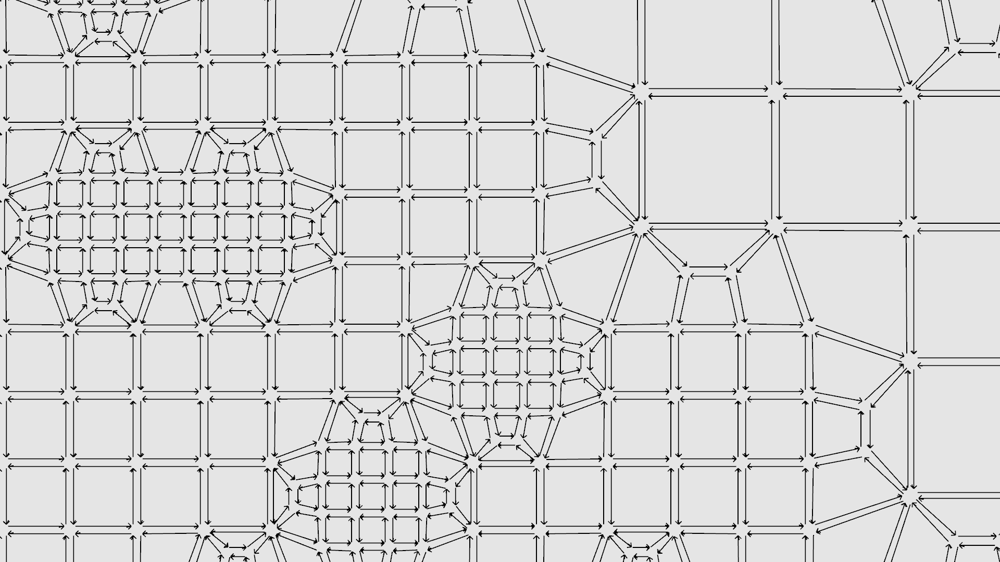
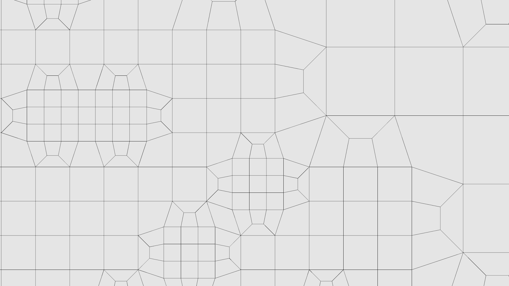
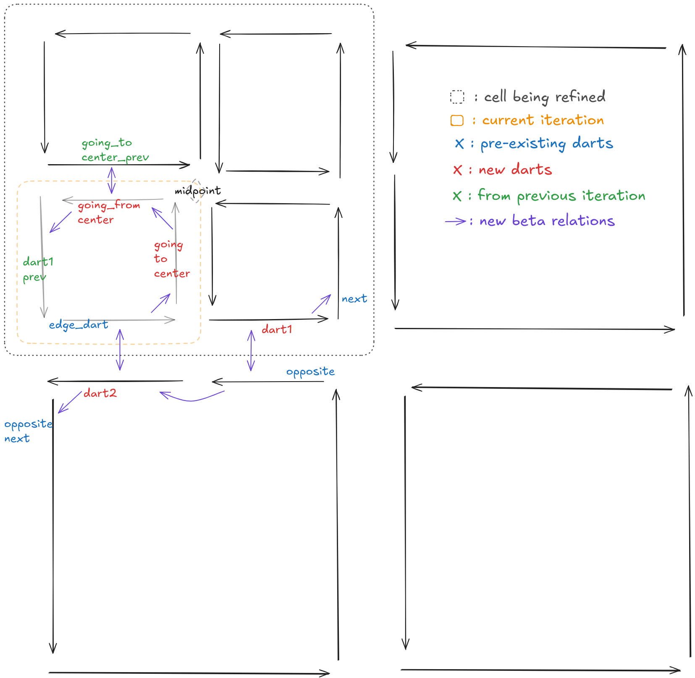

# overlaygrid-honeycomb




[honeycomb](https://github.com/LIHPC-Computational-Geometry/honeycomb) kernel that generate a quad/hex mesh from an input geometry using overlay-grid methods.

Currently only in 2D, and input geometry is a set of vertice.

Algorithm overview:
```
while !max_depth{
    refine()
    balance()
}
regularize()
dualize()
```

### Usage
Usage: overlay_grid [OPTIONS]

Options:
- -f, --vtk-file <VTK_FILE>    VTK file path to use as input
- -n, --nb-verts <NB_VERTS>    Number of vertices to generate for random grid [default: 100]
- -d, --max-depth <MAX_DEPTH>  Maximum refinement depth (default: 10) [default: 10]
- -h, --help                   Print help

Notes regarding multithreading:

- Binding is only enabled if the feature bind-threads is enabled (which it is by default). This allows compiling without an hwloc install if needed.
- The number of thread used by rayon now defaults to 1. A different value can be set using the RAYON_NUM_THREADS environment variable.
- The binding policy an be changed by setting the RAYON_PROC_BIND environment variable. This has roughly the same effect as the OMP_PROC_BIND variable


### Cell division variable naming


### References
- F. Jaillet and C. Lobos, “Fast Quadtree/Octree adaptive meshing and re-meshing with linear mixed elements,” Engineering with Computers, vol. 38, no. 4, pp. 3399–3416, Aug. 2022, doi: 10.1007/s00366-021-01330-w.
- J. Díaz, C. Lobos, and N. Hitschfeld-Kahler, “Node-Based Data Structure for Balancing Process Optimization of Quadtree Meshes,” in 2023 42nd IEEE International Conference of the Chilean Computer Science Society (SCCC), Concepcion, Chile: IEEE, Oct. 2023, pp. 1–7. doi: 10.1109/SCCC59417.2023.10315743.
- L. Maréchal, “Maillage hexaédrique par octree : avancées et limites”.
- L. Maréchal, “Advances in Octree-Based All-Hexahedral Mesh Generation: Handling Sharp Features,” in Proceedings of the 18th International Meshing Roundtable, B. W. Clark, Ed., Berlin, Heidelberg: Springer Berlin Heidelberg, 2009, pp. 65–84. doi: 10.1007/978-3-642-04319-2_5.
- M. Livesu, L. Pitzalis, and G. Cherchi, “Optimal Dual Schemes for Adaptive Grid Based Hexmeshing,” ACM Trans. Graph., vol. 41, no. 2, pp. 1–14, Apr. 2022, doi: 10.1145/3494456.
